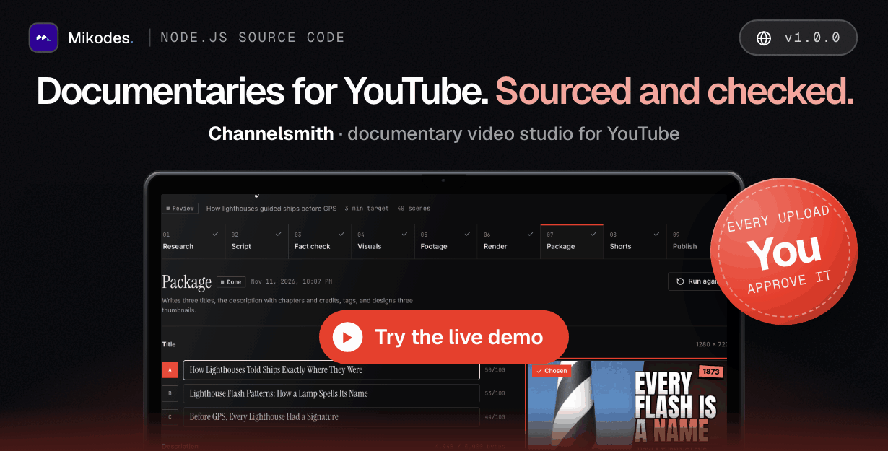
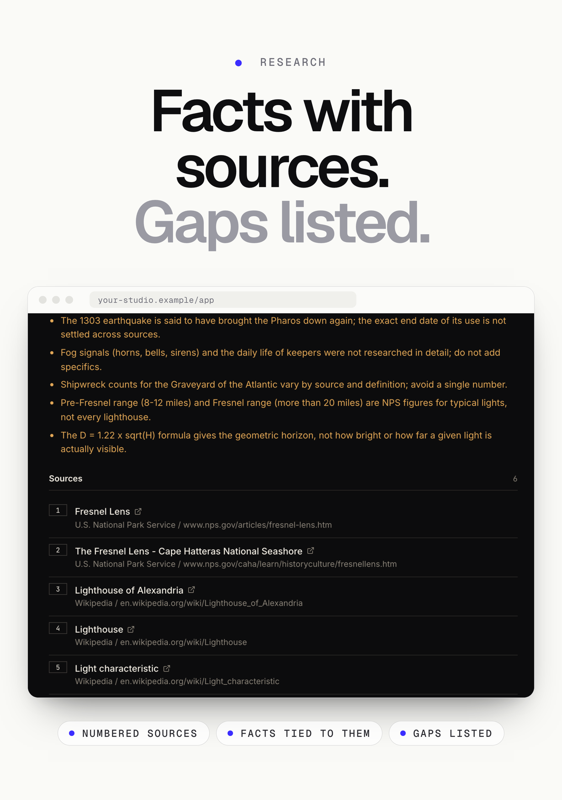
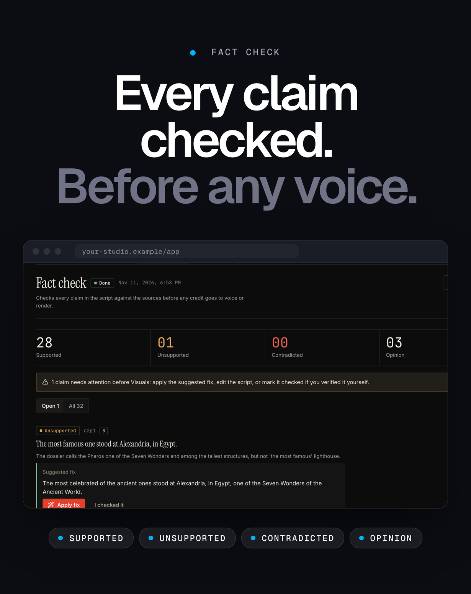
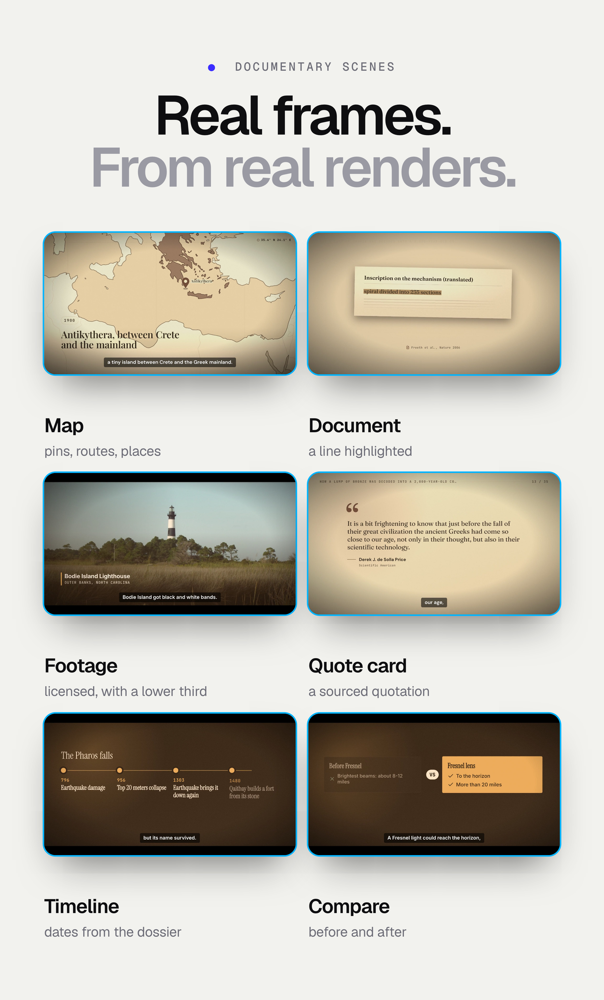
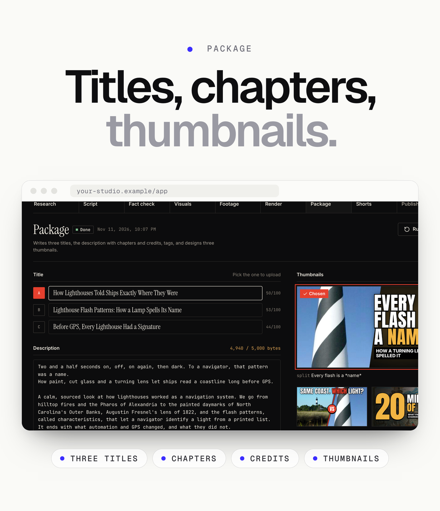
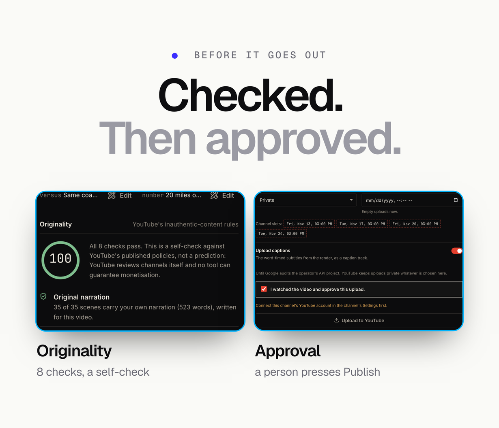
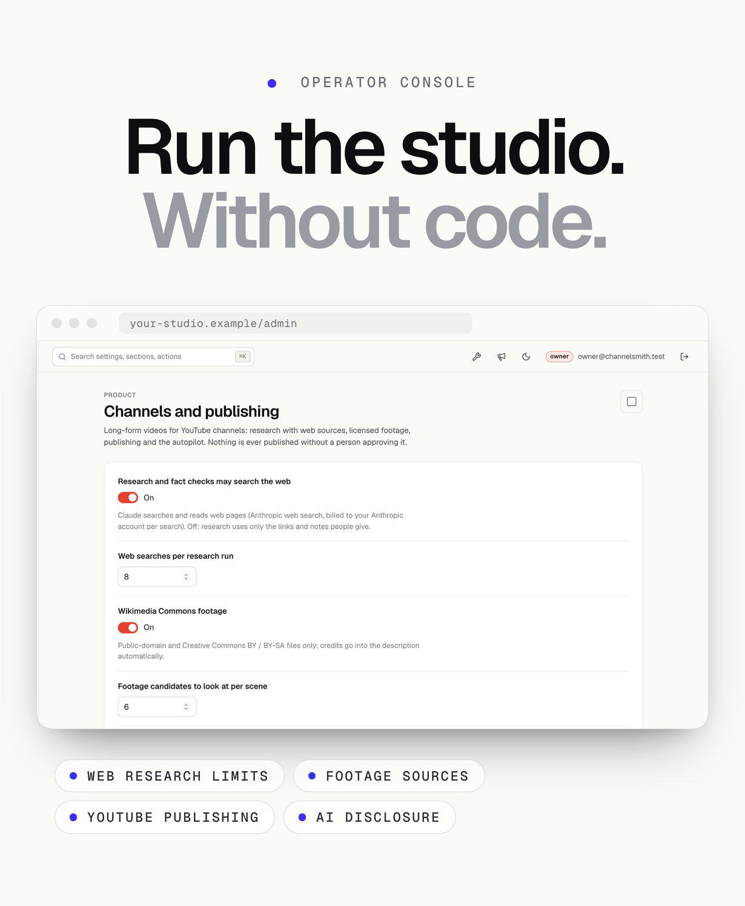

  

<h1 align="center">Channelsmith</h1>

  <b>Self-hosted documentary video studio for YouTube.</b> 
  Research with cited sources → fact-checked script → maps, documents and licensed footage → voiceover → render → YouTube. 
  A person approves every upload.

  <a href="https://channelsmith-demo.mikodes.com/"><b>▶ Live demo</b></a> ·
  <a href="https://channelsmith.mikodes.com/docs/"><b>Docs</b></a> ·
  <a href="https://channelsmith.mikodes.com/"><b>Website</b></a> ·
  <a href="https://store.mikodes.com/p/channelsmith/"><b>Get the full source code</b></a>

  
  
  
  
  
  

  

> **This repository is a showcase.** It holds screenshots, documentation pointers and a few
> real excerpts from the code. The full application (server, studio, renderer, admin console,
> Docker files, tests and docs) is sold as source code at
> **[store.mikodes.com/p/channelsmith](https://store.mikodes.com/p/channelsmith/)**:
> one payment, instant ZIP download, free setup help.

---

## What it does

Channelsmith takes a topic and makes a 10–20 minute documentary or explainer episode for a YouTube channel in **nine steps**, each one you can review and edit:

| # | Step | What happens |
|---|------|--------------|
| 1 | **Research** | Claude searches and reads the web. Every fact is tied to a numbered source that was really retrieved; anything without a source moves into a list of gaps. |
| 2 | **Script** | Retention-structured outline (hook, promise, chapters, payoff) and a narration script whose paragraphs cite the facts. |
| 3 | **Fact check** | The script is checked against the dossier before any voice or render money is spent. |
| 4 | **Visuals** | A per-chapter storyboard: maps, documents, quote cards, timelines, comparisons. |
| 5 | **Footage** | Licensed clips from Pexels, Pixabay and Wikimedia Commons, with credits written for you. |
| 6 | **Render** | Voiceover with word timings (ElevenLabs), then a long render with its own Chrome frame renderer and ffmpeg. |
| 7 | **Package** | Three titles, a description with chapters and credits, tags and three thumbnails. |
| 8 | **Shorts** | Vertical Shorts cut from every long video. |
| 9 | **Publish** | YouTube upload with captions, schedule, playlist and the synthetic-content disclosure, after a person ticks “I watched the video and approve this upload”. |

## Screens

 

 

 

## Features

- **Channels with a channel bible**: niche, audience, language, tone, style pack, topics to avoid, sign-off. Every episode inherits it.
- **Idea Lab**: video ideas with hook, angle and three title variants; approved ideas feed the queue.
- **Ten documentary style packs** with a film look, plus a scene editor.
- **Natural Earth maps**: pins, routes and places rendered offline.
- **Originality report**: eight self-checks against YouTube's published policies (a self-check, not a guarantee).
- **Content calendar, pipeline board and an autopilot that always stops at review.**
- **Workspaces, team roles, brand kits and client review links.**
- **Credits, plans and Stripe billing** if you sell the studio to creators.
- **Operator console**: settings, limits, keys, team and audit without touching code.
- **REST API, signed webhooks, MCP server and an episode CLI.**
- **Backups, restore, upgrade check, Docker.**

## Tech stack

| Layer | Technology |
|-------|------------|
| Server | Node.js 22, TypeScript, Hono, better-sqlite3, Zod |
| Studio | React 19, Vite |
| AI | Anthropic Claude (with web search and fetch), ElevenLabs |
| Render | puppeteer-core (Chrome) + ffmpeg |
| Footage | Pexels, Pixabay, Wikimedia Commons |
| Deploy | Docker or Ubuntu VPS |

## A look at the code

A real excerpt is in [`snippets/clean-dossier.ts`](snippets/clean-dossier.ts): the function that removes every source Claude did not actually retrieve, renumbers the rest and moves unsupported facts into the list of gaps. This is why a Channelsmith script cannot cite a page nobody read.

## Requirements (full version)

- Node.js 22.12+, Google Chrome or Chromium, ffmpeg and ffprobe
- A Linux VPS or Docker host with HTTPS
- Your own API keys: Anthropic, ElevenLabs, Pexels and/or Pixabay (free)
- For public YouTube uploads: a Google Cloud project with the YouTube API (Google keeps uploads private until it audits your project)

Not included: hosting, API usage costs, any audience or revenue. No text-to-video model, no AI avatars and no reuse of other creators' videos.

## Get the full source code

  

One payment, full licence, instant ZIP download and free setup help.
Questions: [mikodes.com/support](https://mikodes.com/support).

---

  Made by <a href="https://mikodes.com"><b>MIKODES</b></a> · <a href="https://github.com/Mikodesteam">more projects</a>

