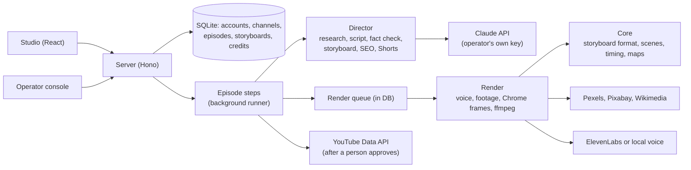

# How Channelsmith works

A case study of the engineering behind a self-hosted documentary video studio for YouTube. It is written from
the real code; the three excerpts linked below are verbatim pieces of it. The complete application is not in this
repository.

## The problem

Making a 10 to 20 minute documentary or explainer is a long chain of jobs: find facts, write a script, check the
claims, find or design visuals, record a voice, render, write the title and description, upload. Teams that do it
for a channel need the chain to be repeatable, but a language model that writes the whole thing in one go invents
sources, repeats itself and gives you no place to stop and check. Channelsmith is built for people who run a
YouTube channel (or several) and want AI to do the heavy lifting **inside a pipeline with checkpoints**, where
every step is reviewable and nothing is published without a person.

## Architecture

One Node.js server (Hono, SQLite) with a React studio in front of it and three engine packages behind it.

- **Core** (`packages/core`) defines the storyboard: a list of scenes (footage, maps, documents, charts, quote
  cards, timelines and so on), each with narration text. It validates storyboards, plans timing and composes the
  whole film into one HTML page.
- **Director** (`packages/director`) holds everything the AI writes. Each step is a function with a schema and a
  set of extra rules.
- **Render** (`packages/render`) records narration, fetches footage, captures the composed page frame by frame in
  Chrome and encodes it with ffmpeg.
- **Server** (`src/server`) owns accounts, workspaces, channels, episodes, credits, the render queue, the
  autopilot, review links, the REST API and the operator console.

## One flow end to end: from an approved idea to a rendered, packaged episode

An episode walks nine named steps: research, script, fact check, produce (storyboard), footage, render, package,
shorts, publish. The same chain is what the autopilot runs for a channel with a posting schedule.

1. **Idea.** The Idea Lab proposes ideas (hook, angle, length, three title variants). A person approves some.
   Titles already used by the channel are sent to the model, and an idea that repeats one is flagged for repair.
2. **Charge.** Before any step runs, the server charges credits; if the step fails the same credits are paid back.
   A broken result never costs the customer.
3. **Research.** Claude searches and fetches pages with Anthropic's server tools. Every fact it returns cites a
   numbered source. The server then runs `cleanDossier` ([excerpt](../snippets/clean-dossier.ts)): it keeps only
   sources that were really retrieved in this run (or supplied by the channel owner), renumbers them from 1, and
   moves any fact left without a source into a list of **gaps** the script writer may not use as fact.
4. **Outline and script.** A retention-structured outline (hook, promise, chapters, payoff) and a narration
   script. Every paragraph lists the fact ids it relies on.
5. **Fact check.** Each claim in the script is marked supported, unsupported, contradicted or opinion, with sources
   and a suggested fix. This happens **before** voice and render credits are spent. In autopilot a flagged claim
   without a fix stops the chain for a person to settle.
6. **Produce.** One Claude call per chapter turns paragraphs into scenes. Each answer goes through the
   validated-answer loop ([excerpt](../snippets/validated-answer.ts)) and the chapter rules (next section).
7. **Footage.** Broll scenes carry a search query; footage is searched and downloaded from three providers under
   the network rules ([excerpt](../snippets/footage-network-rules.ts)), and credits for the description are
   recorded with each clip.
8. **Render.** The server charges for the estimated length, queues the render, records narration with word
   timings, plans scene timing from the real spoken length, composes the HTML page and captures it. After the
   voice exists, the real length is known; if it exceeds what the plan allows the render stops and refunds.
9. **Package.** Three titles, a description with chapters, sources and footage credits, tags, three thumbnails,
   and an originality report (see decisions). **Shorts** cuts vertical clips from the long video.
10. **Publish.** Only after a person approves in the studio (below).

## Key engineering decisions

### 1. Validate every AI answer with a schema and domain rules, and repair with the exact problems

*Chosen:* each step asks for JSON, parses it, validates it with a Zod schema, then runs step-specific checks,
splitting problems into **hard** (must fix) and **soft** (should fix). Problems go back to the model as a bullet
list with the instruction to fix only what is pointed at, and the loop stops after two repairs.
*Alternative:* trust the first answer, or retry blindly. *Why:* a 15-minute film has hundreds of scenes; one bad
prop would otherwise surface as a render failure an hour later. Repairs are cheap and specific, and the repair
prompt explicitly forbids fixing a problem by inventing a fact or source.

### 2. Make the narration the script, word for word

*Chosen:* when the model splits a chapter's script into scenes, the server compares the concatenated `say` text with
the chapter's paragraphs using a word-level longest-common-subsequence check (case and punctuation ignored, a
two-percent tolerance). If words were rewritten or dropped, that is a hard problem.
*Alternative:* let the storyboard model paraphrase. *Why:* the script was fact-checked. Anything that changes
after the check is unchecked text going on air.

### 3. Facts on screen must name the facts they show

*Chosen:* scene types that put claims on screen (documents, newspapers, rankings, charts, stats, timelines, quote
cards) must list the dossier fact ids they display, and each id must belong to that chapter. Footage and kinetic
text scenes are exempt.
*Alternative:* free-form text on graphics. *Why:* it keeps a chain from source to screen, and when a fact is later
removed from the dossier the affected scenes can be found.

### 4. A credit ledger that charges first and refunds on failure

*Chosen:* debit before the work starts, refund on failure or cancel, with a second debit if the voice turns out
longer than estimated. The queue lives in the database so a restart resumes.
*Alternative:* bill after success. *Why:* long jobs on an operator's own server can crash; charging first stops
free-riding on queue time and refunding keeps the customer's trust. The cost is more bookkeeping, which the
ledger rows (with a reference to the render) make auditable.

### 5. An allowlist for downloads instead of a general fetcher

*Chosen:* footage is downloaded only from the hosts each provider serves media from, over https on port 443
without credentials, with redirects re-checked and capped, size caps and a magic-byte check, and a per-host
back-off when a host answers 429.
*Alternative:* download whatever URL an API response contains. *Why:* the URL comes from a third-party API
response, so it is untrusted input to a server that has a filesystem and an internal network.

## Security and safety measures that exist in the code

- **No upload without approval.** `queuePublish` refuses unless the channel is connected, the package exists and a
  rendered file exists; it records which user approved; it refuses a second concurrent upload of the same video; a
  scheduled time must be at least 15 minutes away. The server never publishes on its own, and the autopilot stops
  at "Ready for review".
- **Disclosure.** The YouTube upload sets the synthetic-media flag from the channel's profile or the operator
  default (on unless turned off).
- **Originality report.** Before upload the package is scored on checks such as: narration share, words per minute,
  not mostly stock footage, no repeated shots or identical scenes, sources listed, credits listed, disclosure. The
  failed checks explain what to change. It is guidance for the person approving, not a guarantee of anything.
- **Secrets.** A workspace's own AI key is stored sealed with AES-256-GCM (versioned format, random 12-byte IV,
  auth tag); an unseal with the wrong key or a damaged value returns null. Operator keys live in the console's
  encrypted store.
- **Request limits.** One body-size limit for every route, enforced before a route reads the body, including
  chunked bodies; upload routes have their own larger limits. Sessions are httpOnly SameSite=Lax cookies with
  hashed tokens, and sign-in is rate limited.
- **Webhooks.** The Stripe webhook verifies the HMAC signature in constant time with a five-minute tolerance
  before anything is trusted.
- **Footage network rules.** As above: allowlist, https only, no credentials, redirect cap, size caps.

## How you would build something like this

The order matters more than the details.

1. **Start with the data contract, not the model.** Define the storyboard format first: scene types, their props
   as schemas, narration per scene. Everything else (AI, editor, renderer, API) speaks it. Write a validator that
   returns paths and messages a model can act on.
2. **Make the renderer deterministic.** Compose the film into a single page driven by a time value, so any frame
   can be captured on demand and renders can be split into parallel parts. Do this before touching AI, using
   hand-written storyboards.
3. **Add a wrapper that returns validated answers.** One function: ask, parse, validate, repair with the list of
   problems, give up after a small number of attempts. Make the model client injectable so tests run on canned
   answers.
4. **Build the research step around provenance.** Keep sources and facts as separate lists, require facts to cite
   sources, and post-process: drop what was not retrieved, renumber, move the unsupported into "gaps".
5. **Chain the steps as resumable jobs.** Each step has an input, an output stored in the database, a charge and a
   refund path. A step must be re-runnable on its own so a person can edit and continue.
6. **Put checks before the expensive stage.** Fact check and storyboard validation come before voice and render,
   because those are the stages that cost time and money.
7. **Treat every external URL as hostile.** Allowlist hosts, cap sizes, verify content types.
8. **Gate publishing on a human.** Record who approved, not just that someone did.

## Deployment and customization

Channelsmith ships as a Node.js 22 application with a Dockerfile; Chrome and ffmpeg run on the same server, and
all data lives in one data directory (SQLite files plus uploads, footage and renders) that you back up by copying.
Keys for Claude, ElevenLabs, the footage providers, YouTube, Stripe and e-mail are your own and are set in the
operator console. Things people change: the style packs and themes (ten ship), scene types, the prompts, the
plans and credit prices, branding of the studio and console, and the language of the channels.

Full source code, docs and setup help: https://store.mikodes.com/p/channelsmith/
